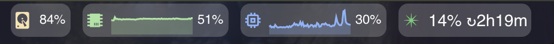

# Canopy

A macOS status bar and window management setup built on [sketchybar](https://github.com/FelixKratz/SketchyBar) and [AeroSpace](https://github.com/nikitabobko/AeroSpace).



## What's in the box

**Left side** — AeroSpace workspace indicators with single-letter labels (C, D, W, B, T, N, S, M, P, Q). Active workspace is highlighted; workspaces with windows show a dot.

**Right side** — a set of toggleable status items:

| Item | Source | What it shows |
|------|--------|---------------|
| CPU / RAM / Disk | `sysctl` / `memory_pressure` / `df` | Live sparkline graphs + disk usage |
| Claude usage | [claude-usage-api](claude-usage-api/) | API spend vs. daily cap |
| Calendar | [mac-status-api](mac-status-api/) via icalBuddy | Current/next meeting with countdown |
| Slack | mac-status-api via lsappinfo | Unread badge count |
| Email | mac-status-api via Mail.app | Unread count |
| Media | nowplaying-cli | Track title + playback controls |

> **App requirements:** Slack shows badge data via `lsappinfo`, so **Slack.app** must be running. Email queries unread counts via AppleScript, so **Mail.app** must be running. Calendar reads events via **icalBuddy** (`brew install ical-buddy`), which must be installed. All three require the [mac-status-api](mac-status-api/) service.

The bar floats as a translucent pill with rounded corners, positioned at the top of the screen.

## Prerequisites

- macOS
- [Homebrew](https://brew.sh)
- Node.js (for the backing APIs)

## Quick start

```bash
git clone https://github.com/yourusername/canopy.git ~/dev/canopy
cd ~/dev/canopy
./setup.sh
```

The setup wizard will:
1. Install sketchybar and AeroSpace if missing
2. Ask which items to enable
3. Generate your `config.sh`
4. Symlink configs into `~/.config/sketchybar` and `~/.aerospace.toml`
5. Install backing services (mac-status-api, claude-usage-api) via launchd

Then restart sketchybar:

```bash
brew services restart sketchybar
```

## Configuration

Run `./setup.sh` again to change which items are enabled. Your choices are saved to `config.sh` (gitignored).

See [config.example.sh](config.example.sh) for all available options.

## Plugins

Canopy supports external plugin directories. Point `PLUGIN_DIRS` in your config at one or more folders containing plugins, each with an `item.sh` entry point:

```
my-plugins/
  my-plugin/
    item.sh
    plugin.sh
```

Enable them by name in `ENABLED_PLUGINS` or through the setup wizard.

## Backing services

| Service | Port | Purpose |
|---------|------|---------|
| [mac-status-api](mac-status-api/) | 7778 | Calendar, Slack, and email data over HTTP |
| [claude-usage-api](claude-usage-api/) | 7779 | Claude API usage polling via OAuth |

Both run as launchd services (localhost only, auto-restart on crash). See their directories for details.

## AeroSpace

The included `aerospace.toml` provides a letter-based workspace scheme designed for a multi-monitor setup. Workspaces are assigned to monitors and apps are pinned to workspaces via `on-window-detected` rules. Adjust the monitor numbers at the top of the file to match your layout.

## Project structure

```
canopy/
  setup.sh                  # Interactive setup wizard
  config.example.sh         # Config template
  aerospace.toml            # AeroSpace window manager config
  sketchybar/
    sketchybarrc             # Entry point — loads items based on config
    bar.sh                   # Bar appearance (floating pill)
    colors.sh                # Color palette
    defaults.sh              # Shared item defaults
    items/                   # Item definitions (*.item.sh)
    plugins/                 # Plugin scripts (data fetching + display)
  mac-status-api/            # Node.js status server (calendar, slack, email)
  claude-usage-api/          # Node.js Claude usage tracker
  scripts/                   # Helper scripts (app launcher, etc.)
  docs/                      # Screenshots
```